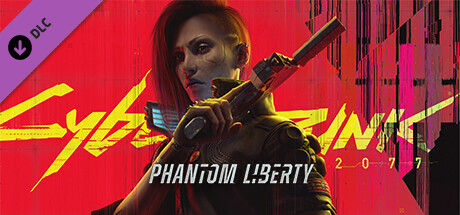

**Cyberpunk 2077: Phantom Liberty by CD Projekt Red (2023) is the massive expansion to the base game, adding Dogtown district and a spy-thriller storyline with Idris Elba.**

---

## 📖 About

Cyberpunk 2077: Phantom Liberty by CD Projekt Red (2023) is the massive expansion to the base game, adding Dogtown district and a spy-thriller storyline with Idris Elba. The Relic skill tree and new cyberware overhauled the entire game's build system.

## ⚠️ Problems Without Trainer

| Problem | Status |
|---------|--------|
| Relic perk investment locks playstyle in directions hard to reverse late-game | ✅ Solved |
| Cyberpsychosis risk spikes with heavy cyberware investment removing key abilities | ✅ Solved |
| Phantom Liberty bosses require specific damage types and vulnerabilities knowledge | ✅ Solved |
| Gig reputation required for best Phantom Liberty cyberware vendor items | ✅ Solved |
| Quickhack RAM capacity insufficient for chained takedowns without specific builds | ✅ Solved |

## ✅ Solution

The **Cyberpunk 2077: Phantom Liberty Trainer** solves all these issues, giving you complete control so you can focus on enjoying the game.

## 🎯 Features

- Unlimited Resources / Currency
- God Mode / Invincibility
- Instant Skill & Ability Cooldown
- One-Hit Kill
- Freeze Timers
- Unlock All Items & Achievements
- Custom Speed Multiplier
- Infinite Stamina / Energy

## 🚀 Quick Start

1. **Disable Windows Defender** temporarily (trainer may trigger false positive)
2. Get the trainer from the button above
3. Launch Cyberpunk 2077: Phantom Liberty
4. Run the trainer as Administrator
5. Use the hotkeys to activate cheats in-game

## 💎 Free vs Pro

| Feature | Free | Pro |
|---------|------|-----|
| God Mode | ✅ | ✅ |
| Unlimited Resources | ✅ | ✅ |
| Advanced Cheats | ❌ | ✅ |
| Auto-Updates | ❌ | ✅ |
| Priority Support | ❌ | ✅ |

## 💻 Requirements

- Windows 10 / 11 (64-bit)
- Cyberpunk 2077: Phantom Liberty (any version)
- .NET Framework 4.8+
- DirectX 11+

## 🍎 macOS

## ⚖️ Legal

Educational and single-player use only.

---

